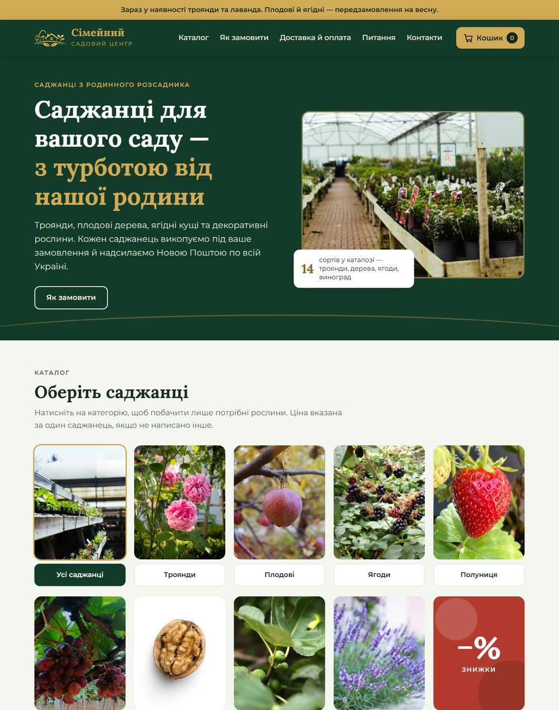
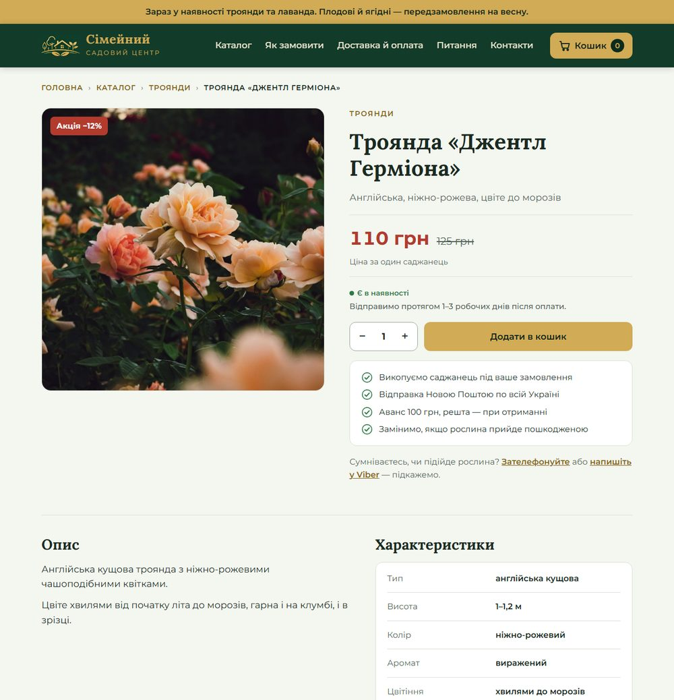
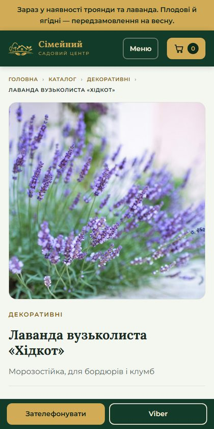
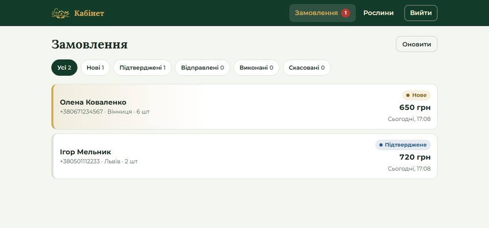
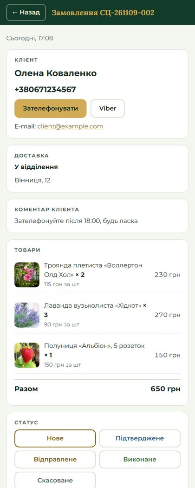
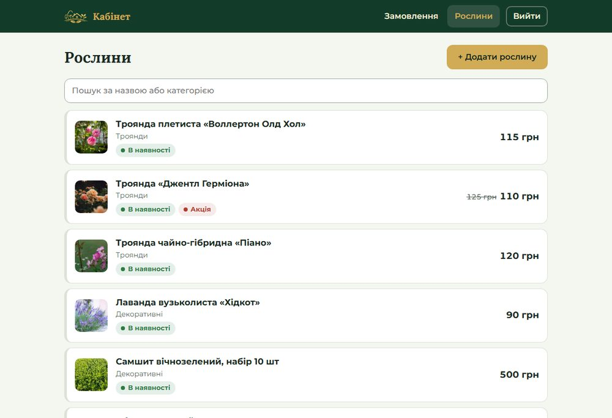
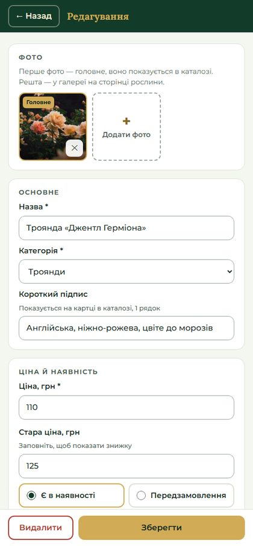
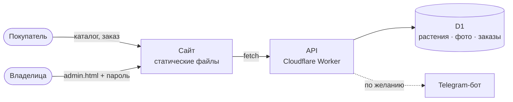

# 🌱 Сімейний садовий центр

Интернет-магазин саженцев семейного питомника (розы, плодовые деревья, ягоды, декоративные растения) с собственным кабинетом владелицы: заказы, каталог, фото и цены меняются прямо с телефона, без программиста.

**Сайт:** https://sadovyi-centr.sadovyi-centr-api.workers.dev
**Кабинет:** кнопка «Адмін» в подвале сайта (`/admin.html`), вход по паролю

<p align="center">
  
</p>

---

## Что умеет

### Для покупателя
- **Каталог с плитками категорий** на фото: троянди, плодові, ягоди, полуниця, виноград, горіхи, екзотичні, декоративні, акційні.
- **Страница каждого растения**: галерея, цена (старая цена зачёркнута для акций), наличие или «передзамовлення», описание, характеристики, «Схожі саджанці». У каждой страницы своя ссылка (`#p-5`), её можно отправить в мессенджер.
- **Корзина и оформление заказа**: имя, телефон, Нова Пошта (отделение, почтомат или курьер), комментарий. Минимальная сумма 300 грн.
- **Экран «Замовлення надіслано»** с номером заказа и кнопками «Зателефонувати» и Viber.
- **Адаптивность и тёмная тема**: удобно на телефоне, тёмная тема включается автоматически по настройке системы.

### Для владелицы (кабинет)
- **Заказы**: список с фильтром по статусам (Нове → Підтверджене → Відправлене → Виконане / Скасоване), счётчик новых заказов, автообновление каждые 45 секунд.
- **Карточка заказа**: клиент с кнопками звонка и Viber, доставка, комментарий, товары с фото, смена статуса в одно нажатие, «нотатка для себе» (например, «аванс получен, ТТН …»).
- **Растения**: добавить, изменить, скрыть с сайта или удалить. До 10 фото на растение, первое главное; фото сжимаются прямо в браузере. Есть цена и старая цена, наличие, описание и характеристики.
- **Изменения сразу на сайте**, без перевыкладки.

## Скриншоты

| Страница растения | На телефоне |
|---|---|
|  |  |

| Кабинет: заказы | Карточка заказа |
|---|---|
|  |  |

| Кабинет: растения | Редактор растения |
|---|---|
|  |  |

<sub>На скриншотах кабинета тестовые заказы с вымышленными данными.</sub>

## Как устроено



- **Сайт** — обычные HTML, CSS и JS без фреймворков и сборки. Выложен на Cloudflare как Worker со статическими файлами.
- **API** — один Cloudflare Worker ([`order-bot/src/worker.js`](order-bot/src/worker.js)): отдаёт каталог, принимает заказы, обслуживает кабинет.
- **База** — Cloudflare D1 (SQLite). Фото хранятся там же и отдаются с долгим кэшем.
- **Стоимость**: 0 грн в месяц, всё помещается в бесплатный тариф Cloudflare. Платить придётся только за собственный домен, когда он появится.

## Структура репозитория

```
site/                   сайт
  index.html            магазин: каталог, страница товара, корзина, оформление
  admin.html            кабинет владелицы
  shared.js             адрес API и список категорий (общий для сайта и кабинета)
  demo.js               демо-режим: всё работает в браузере, пока API не подключён
  oferta.html           публичная оферта
  img/                  фото
order-bot/              API (Cloudflare Worker + D1)
  src/worker.js         все эндпоинты
  schema.sql            схема базы
  seed.sql              стартовый каталог (14 растений)
  wrangler.toml         конфиг API
  site.wrangler.toml    конфиг выкладки сайта
docs/screenshots/       картинки для этого README
```

## Выложить изменения

Нужны Node.js и доступ к аккаунту Cloudflare.

```bash
cd order-bot
npm install
npx wrangler login                          # один раз
npx wrangler deploy                         # API
npx wrangler deploy -c site.wrangler.toml   # сайт (папка ../site)
```

Запуск с нуля (новая база, пароль, Telegram) и локальная разработка описаны в [`order-bot/README.md`](order-bot/README.md).

### Где что менять

| Что | Где |
|---|---|
| Растения, цены, фото, наличие | в кабинете, код трогать не нужно |
| Телефон, Instagram, минимальная сумма, аванс | `CONFIG` в начале скрипта `site/index.html` |
| Категории и их фото | `CATEGORIES` в `site/shared.js` |
| Пароль кабинета | `npx wrangler secret put ADMIN_PASSWORD` |
| Уведомления о заказах в Telegram | секреты `BOT_TOKEN` и `CHAT_ID` (см. `order-bot/README.md`) |

## Безопасность

- Пароль кабинета хранится только в секретах Cloudflare, в коде его нет. Сессия живёт 30 дней. После 10 неверных попыток вход с этого IP блокируется на 15 минут.
- Сервер сам считает сумму заказа по ценам из базы, подделать цену в браузере нельзя.
- Заказы принимаются только с адреса сайта (`ALLOWED_ORIGINS`). Скрытое поле-ловушка отсекает спам-ботов.

## Что ещё в планах

- [ ] Собственный домен (`.com.ua`)
- [ ] Уведомления о новых заказах в Telegram (код готов, нужен токен бота)
- [ ] Реквизиты ФОП, адрес и дата в публичной оферте
- [ ] Владелице проверить описания и характеристики растений (сейчас там примерные тексты)
